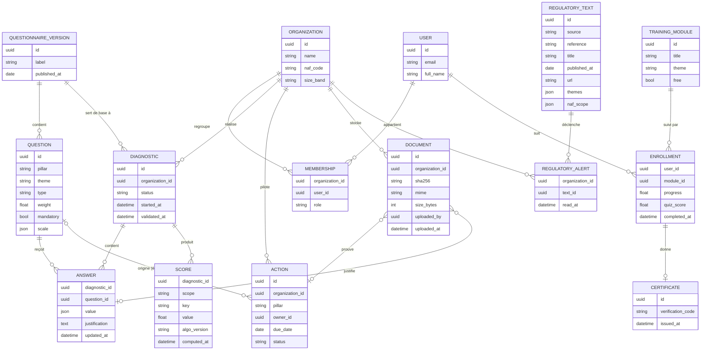

# Réglo — Note de cadrage data : stratégie et architecture

> **Statut : proposition v0.2, à valider en équipe** (réunion du 16 octobre).
> Carte Trello : « Stratégie et architecture data » (PHASE A, échéance proposée 23 oct.).
> Base : dossier technique jalon 1 de l'équipe dev (`googledrive/Le projet.docx`), US E01 à E07.
> Les éléments marqués **[À DÉCIDER]** sont des options, pas des choix. Les justifications finales
> et l'édito de la partie data sont à rédiger par Alexis (règle IA, niveau 1).

---

## 1. Ce que la data apporte à Réglo

Réglo relie **diagnostic → action → formation → preuve**. La data sert les quatre maillons :

| Fonctionnalité (dossier projet) | Besoin data | Livrable data |
|---|---|---|
| 5. Diagnostic et auto-évaluation (US-03, US-04, US-10) | Calcul du score global, par pilier et par thématique, historisé | Service de score + modèle de données |
| 6. Tableau de bord central | Indicateurs agrégés par organisation (score, actions, formations, documents) | Couche analytique + API d'indicateurs |
| 7. Plan d'actions (US-05, US-06) | Actions proposées depuis les écarts du diagnostic ; retards, échéances | Règles de recommandation (v1 simple) |
| 4. Suivi de progression des équipes | Avancement, réussite, retards par salarié | Indicateurs de formation |
| 3. Certifications en ligne | Identifiant vérifiable du certificat | Modèle de données (code de vérification) |
| 10 + E07. Veille réglementaire (US-11) | Textes récents, classés par thème (Loi Climat, CSRD, Déchets, Social), alertes | Chaîne de collecte automatisée (prototype existant : `../veille-marche/`) |
| Pilotage Réglo (interne) | Adoption, santé applicative, retours, entonnoir | BI admin (trame existante : `../bi-admin/`) |
| Étude de marché (équipe business) | Taille de marché, sinistralité, concurrence, appels d'offres | Veille marché (en ligne, collecte quotidienne) |

**Positionnement proposé [À DÉCIDER]** : produit **data-centric** sur deux points (score du diagnostic,
veille réglementaire), **data-driven** pour le pilotage interne (BI admin, veille marché).

---

## 2. Périmètre data du MVP (proposition)

| Priorité | Élément | Dépend de |
|---|---|---|
| **Must** | Modèle de données partagé (diagnostic, réponses, scores, veille) | Devs (Doctrine) |
| **Must** | Calcul du score v1 (barème et pondérations) | Contenu du questionnaire (expertise QHSE / business) |
| **Must** | Veille réglementaire : textes, thèmes, filtre (US-11) | Clés API Légifrance |
| **Must** | Conformité : registre des traitements, multi-tenant, politique de confidentialité | Devs, cyber |
| **Should** | Indicateurs du tableau de bord client (fonctionnalité 6) | API Symfony |
| **Should** | Contrat d'événements et BI admin branché | Devs (émission des événements) |
| **Could** | Actions recommandées automatiquement depuis le diagnostic | Score v1 stabilisé |
| **Could** | IA : classement / résumé des textes réglementaires | Analyse IA Act, budget |

---

## 3. Architecture proposée

Cohérente avec le dossier technique : architecture découplée, API-first, un **petit service data
Python** distinct de l'API, une seule base PostgreSQL, tout en conteneurs Docker sur le VPS de l'école.

```
                               ┌──────────────────────── VPS école (Docker Compose, HTTPS) ────────────────────────┐
  Navigateur ──► Next.js ──────► API Symfony + API Platform ─────────────► PostgreSQL                               │
  (clients,      (interface)    (logique métier, droits,                  ├─ schéma app      (Doctrine, devs)       │
   admin Réglo)                  multi-tenant)                            ├─ schéma veille   (service data)          │
                                    │        ▲                            └─ schéma analytics (vues agrégées, data) │
                                    │ HTTP   │ scores                                ▲            ▲                  │
                                    ▼        │                                       │            │                  │
                               Service data FastAPI (Python) ─────────────────────────┘            │                  │
                               ├─ /scores : calcul du score d'un diagnostic                         │                  │
                               ├─ /veille : textes réglementaires filtrés                           │                  │
                               └─ jobs planifiés (cron du conteneur) ── collecte ───────────────────┘                  │
                                         │                                                                             │
                                         ▼                                                                             │
                     Sources publiques : Légifrance (PISTE), EUR-Lex (SPARQL), BODACC, open data Assurance Maladie    │
                               └────────────────────────────────────────────────────────────────────────────────────┘
```

### Principes

1. **Une base, trois schémas, un propriétaire chacun.** `app` appartient à Symfony (migrations
   Doctrine) ; `veille` et `analytics` appartiennent au service data (migrations Alembic). Personne
   n'écrit dans le schéma d'un autre ; les lectures croisées passent par des vues ou par l'API.
2. **Le service data ne voit jamais les données en clair d'une autre organisation que celle demandée.**
   Le calcul du score reçoit les réponses d'un diagnostic, pas un accès libre à la base.
3. **Le service data est sans état côté métier** : l'API Symfony reste la source de vérité et
   l'unique point d'entrée des utilisateurs (droits, rôles, audit).
4. **Tout est rejouable** : un score porte la version de l'algorithme qui l'a produit ; une collecte
   porte sa date et sa source.

### Décisions à prendre **[À DÉCIDER]**

| Sujet | Option A | Option B | Critères |
|---|---|---|---|
| Où calculer le score ? | Service data (Python), appelé par l'API, résultat stocké par l'API | Directement en PHP dans Symfony | Lien avec ma grille (« développement data »), testabilité Pytest, une dépendance de moins si B |
| Stockage de la veille | Schéma `veille` écrit par le service data, lu par l'API via vue | Tables Doctrine alimentées par l'API qui appelle `/veille` | Propriété des données, simplicité côté devs |
| Planification des collectes | `cron` dans le conteneur data | Orchestrateur (Prefect / Dagster) | Ressources du VPS (à confirmer par Florian), besoin réel de reprise sur erreur |
| Dashboards clients | Composants Next.js alimentés par une route d'indicateurs | Outil BI embarqué (Metabase) | Charte graphique, multi-tenant, poids sur le VPS |
| BI admin Réglo | Trame React existante (`../bi-admin/`) intégrée au front | Metabase interne | Effort d'intégration côté devs |
| Cloisonnement dans `analytics` | `organization_id` + contrôle dans l'API | + Row Level Security PostgreSQL | Défense en profondeur vs complexité |

---

## 4. Modèle de données partagé (proposition)

Point de dépendance déclaré par l'équipe dev (« modèle de données partagé pour le service de scores et
de veille »). Toutes les tables métier portent `organization_id` (isolation, cf. dossier technique).



- **SCORE** : une ligne par portée (`global`, `pillar:Social`, `theme:Déchets`…) ; `algo_version`
  permet de recalculer et de comparer deux diagnostics (US-10).
- **QUESTIONNAIRE_VERSION** : un diagnostic reste lié à la version du questionnaire utilisée
  (sinon l'historique devient incomparable dès qu'une question change).
- **REGULATORY_TEXT** : schéma `veille`, sans donnée personnelle ; `naf_scope` sert à n'alerter que
  les secteurs concernés.
- **Événements produit** (BI admin) : table `analytics.event` selon le contrat déjà décrit dans
  `02-bi-admin-fonctionnalites.md` §4.

---

## 5. Calcul du score (cadre, à spécifier dans une carte dédiée)

Proposition de principe **[À DÉCIDER avec l'équipe et l'expertise QHSE]** :

1. Chaque réponse est convertie en **note de 0 à 100** selon le type de question (oui/non, échelle,
   choix multiples) ; « non applicable » est **exclu** du calcul plutôt que compté à zéro.
2. Score d'une thématique = moyenne pondérée des questions (`weight`) ;
   score d'un pilier = moyenne pondérée des thématiques ; score global = moyenne pondérée des piliers.
3. Une question « avec justification » sans justification ni document peut être plafonnée (règle de preuve).
4. Le résultat renvoie aussi les **3 écarts les plus importants** (base des actions proposées, Could).
5. Testé sur des jeux de réponses de référence (tout à 0, tout à 100, non-applicables, cas réels).

---

## 6. Chaîne de traitement (collecte → nettoyage → exploitation)

| Flux | Collecte | Nettoyage / contrôle | Exploitation |
|---|---|---|---|
| Diagnostic | Saisie client via l'API | Champs obligatoires, types, bornes (API) | Score (service data) → tableau de bord, PDF (US-09) |
| Plan d'actions, documents, formations | API | Validation métier (API) ; formats et taille des fichiers | Indicateurs de pilotage (vues `analytics`) |
| Veille réglementaire | Jobs planifiés : Légifrance, EUR-Lex | Déduplication, normalisation des dates, classement par thème, ciblage NAF | Fil d'actualité (US-11), alertes |
| Événements produit | Front / API → `analytics.event` | Schéma imposé, horodatage UTC, pas de donnée de contenu | BI admin |
| Marché (interne) | Veille marché (`../veille-marche/`) | Robots, déduplication, filtres de pertinence | Étude de marché, business plan |

**Qualité des données (mesures prévues)** : complétude des diagnostics, taux de « non applicable »,
fraîcheur de la veille (délai publication → affichage), doublons, cohérence des échéances,
tests automatiques (Pytest) sur le calcul et les collectes.

---

## 7. Sécurité, conformité, sobriété

- **Hébergement en France** (VPS école), sauvegardes quotidiennes (dossier technique).
- **Multi-tenant** : `organization_id` partout, contrôlé par l'API ; agrégats `analytics` jamais
  servis sans filtre d'organisation.
- **Minimisation** : pas de donnée de santé nominative (accidents du travail) dans le MVP ; les
  documents ne sont pas analysés par le service data.
- **IA** : aucune IA dans le MVP proposé ; si le classement/résumé IA de la veille est retenu,
  analyse IA Act (risque minimal, transparence) et fournisseur hébergé dans l'UE.
- **Registre des traitements** : brouillon v0 dans `04-registre-traitements-v0.md`.
- **Sobriété** : jobs planifiés une fois par jour, pas d'orchestrateur lourd tant que le besoin n'existe pas.

---

## 8. Contrat d'API du service data (aperçu)

| Route | Appelée par | Rôle |
|---|---|---|
| `POST /scores` | API Symfony, à la validation d'un diagnostic | Corps : version du questionnaire + réponses ; réponse : scores par portée, écarts, `algo_version` |
| `GET /veille/texts?theme=&naf=&since=` | API Symfony | Textes récents filtrés (US-11) |
| `GET /health` | Infra (Florian) | Supervision |

Erreurs : code et message clairs ; en cas d'indisponibilité, l'API conserve les réponses et affiche
« calcul en cours » (critère d'acceptation US-04).

---

## 9. Risques

| Risque | Parade proposée |
|---|---|
| Barème du score non validé à temps | Score v1 simple (moyennes) et versionné, affiné ensuite |
| Clés Légifrance non obtenues | EUR-Lex + recherches ciblées (déjà en place dans `../veille-marche/`) |
| Ressources du VPS insuffisantes | Pas d'orchestrateur ni d'outil BI lourd ; jobs quotidiens |
| Modèle de données livré trop tard aux devs | Cette proposition, revue avec eux avant le 23 oct. |

---

## 10. Prochaines étapes

- [ ] Relire cette proposition avec les devs (modèle §4, contrat §8) et Florian (VPS, §3)
- [ ] Trancher les **[À DÉCIDER]** et rédiger les justifications (Alexis)
- [ ] Ouvrir les cartes : modèle de données partagé, calcul du score, contrat d'événements,
      veille réglementaire produit (Légifrance)
- [ ] Mettre à jour `01-note-cadrage-strategie-data.md` (objectifs SMART, indicateurs de succès)
